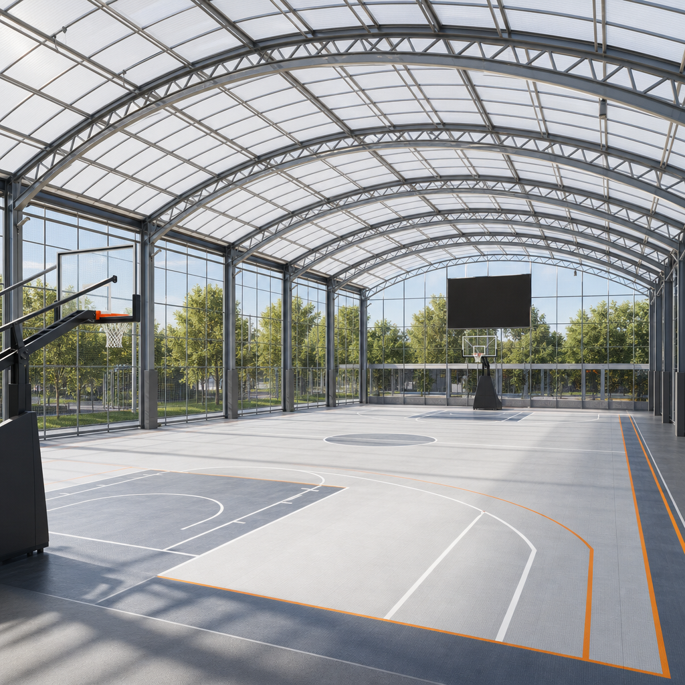
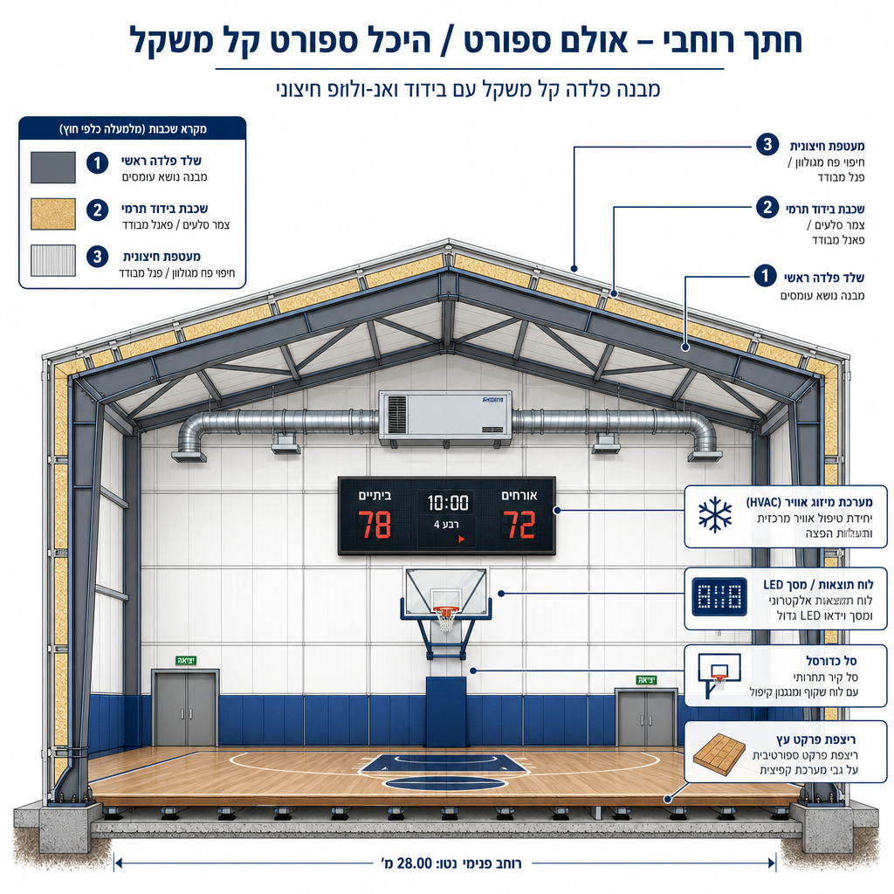
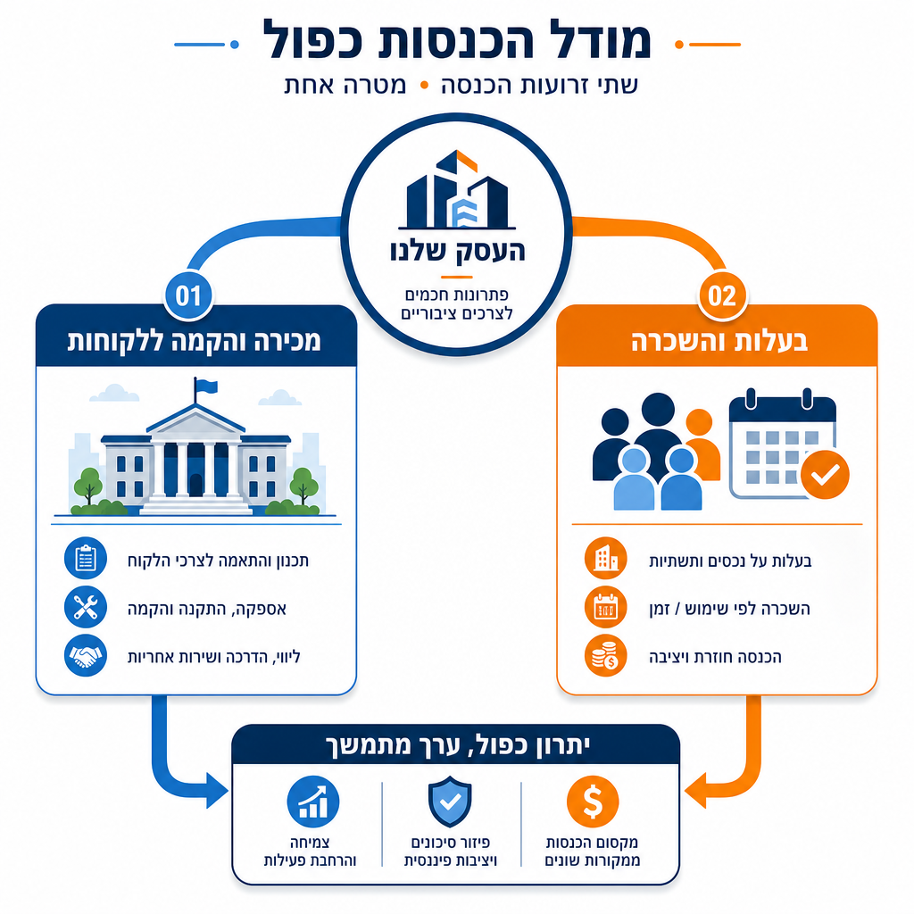

# תוכנית עסקית: קירוי מגרשי ספורט פתוחים בבנייה קלה

**מסמך קונספט ותוכנית עסקית להקמת חברה (בע"מ)**
תאריך: 04.07.2026

---

## 1. תקציר מנהלים

בישראל חסרים אלפי אולמות ספורט. כ-66% מבתי הספר בישראל — כ-3,500 מתוך כ-5,300 — פועלים ללא אולם ספורט תקני, על אף שהקרקע לרוב כבר מיועדת ומסומנת לכך. הצורך הכולל במתקני ספורט מוערך ב-14.9 מיליארד ש"ח, מול תקציב ממשלתי זמין של 2.89 מיליארד ש"ח בלבד — פער עצום שהמדינה לבדה לא תסגור בעשורים הקרובים.

הפתרון המוצע: חברה שמקימה **אולמות ספורט מקורים על גבי מגרשי ספורט פתוחים קיימים** — בבתי ספר, ספורטקים, מתנ"סים ומקומות עבודה — באמצעות קירוי בבנייה קלה. הפתרון כולל מעטפת קירוי מחומרים מובילים, פרקט, מיזוג, שעוני משחק, סלים תקניים, מסך לד, שירותים וחדרי הלבשה. התוצאה: מגרש פתוח שעומד ריק רוב שעות היממה בגלל מזג האוויר, הופך לאולם ספורט תקני הפעיל בכל השנה — עבור כדורסל, כדורעף, כדוריד, כדורשת/פוטסל, התעמלות ואירועים.

היתרון המרכזי הוא כלכלי: עלות הקמה של כ-1.5-2 מיליון ש"ח, לעומת 8-15 מיליון ש"ח לאולם קונבנציונלי — כלומר 15-25% מהעלות בלבד. זמן ההקמה: 2-4 חודשים, לעומת 2-3 שנים בבנייה רגילה.

המודל העסקי כפול: הכנסה ממכירה/הקמה של אולמות עבור לקוחות (רשויות מקומיות, בתי ספר, מתנ"סים, חברות), לצד בעלות עצמית על חלק מהמתקנים והפעלתם להשכרה שוטפת לקהל הרחב — בדומה למודל שהוכיח את עצמו בענף הפאדל, שצומח בישראל בקצב של יותר מ-50% בשנה.

---

## 2. הבעיה וההזדמנות בשוק

### מחסור מתמשך במתקני ספורט

לפי דו"ח מבקר המדינה (2023), לכ-66% מבתי הספר בישראל — כ-3,500 מתוך כ-5,300 — אין אולם ספורט, וזאת חרף העובדה שתוכניות מימון בניית בתי ספר מחייבות ייעוד קרקע לאולם ספורט, גם אם אינן מחייבות את הבנייה בפועל. המשמעות: הקרקע כבר קיימת ומיועדת במקרים רבים, אבל האולם עצמו — לא נבנה, בעיקר בגלל עלות וזמן.

הפער התקציבי חד: הצורך הכולל במתקני ספורט בישראל מוערך ב-14.9 מיליארד ש"ח, לעומת תקציב מתוכנן של 2.89 מיליארד ש"ח בלבד עד שנת 2031 — ומתוכו נוצל בפועל רק כ-59% עד סוף 2022. קיימים גם פערים גיאוגרפיים וחברתיים-כלכליים משמעותיים בנגישות למתקני ספורט, בעיקר באשכולות סוציו-אקונומיים נמוכים וביישובים ערביים וחרדיים, ופגיעה מיוחדת בנגישות למתקנים עבור נשים וילדות.

### ריבוי מגרשים פתוחים שלא מנוצלים

במקביל למחסור באולמות, קיימים בישראל אלפי מגרשי ספורט פתוחים — בבתי ספר, מרכזים קהילתיים (ספורטקים), מתנ"סים ואף בשטחי חברות — שעומדים ריקים רוב שעות היום והשנה בגלל חשיפה למזג אוויר: חום, קור, גשם ורוח. התשתית הבסיסית (משטח מגרש, לעיתים תאורה) כבר קיימת. מה שחסר הוא הקירוי שיהפוך אותם לשמישים כל השנה, בכל שעה.

זו בדיוק ההזדמנות: פתרון שממנף תשתית קיימת, במקום לדרוש בנייה מאפס — ומקצר משמעותית את זמן ועלות ההקמה.

---

## 3. הפתרון — תיאור המוצר

הפתרון הוא קירוי מגרש ספורט פתוח וקיים, בטכנולוגיית בנייה קלה, כך שהוא הופך לאולם ספורט תקני וסגור. החבילה המוצעת כוללת:

- **מעטפת קירוי** מחומרים מובילים בתחום הבנייה הקלה — שלד נושא (פלדה או מתכת קלה) עם ציפוי חיצוני עמיד (ממברנה מתוחה, פאנלים מבודדים או פתרון היברידי, בהתאם לתקציב ולדרישות הלקוח).
- **פרקט ספורט** תקני, המתאים למגוון ענפי ספורט.
- **מיזוג אוויר** מלא, המאפשר פעילות נוחה בכל עונות השנה.
- **שעוני משחק** דיגיטליים תקניים.
- **סלי כדורסל תקניים**, ניתנים להתאמה גם למגרשי כדוריד וכדורעף.
- **מסך לד** לתוצאות, שידורים ותוכן.
- **שירותים וחדרי הלבשה** — תשתית בסיסית הנדרשת לאולם ספורט מלא.

המוצר מיועד לשרת מגוון רחב של ענפי ספורט: כדורסל, כדורעף, כדוריד, כדורשת/פוטסל והתעמלות — הן ברמה התחרותית/הישגית והן ברמה העממית/קהילתית. האולם המקורה גם מתאים לאירועים — טקסים, כנסים קהילתיים ואירועי ספורט מיוחדים.

---

## 4. השוק והלקוחות הפוטנציאליים

השוק בישראל מורכב משלוש קבוצות לקוחות עיקריות:

1. **מגזר ציבורי — רשויות מקומיות ומועצות אזוריות.** אחראיות על תקציבי ספורט מקומיים, מחלקות חינוך וספורט, ולעיתים מקבלות תמיכה ממשרד התרבות והספורט ומקרן הטוטו של מפעל הפיס למתקני ספורט.
2. **מוסדות חינוך וקהילה — בתי ספר, ספורטקים ומתנ"סים.** אלה בדיוק היעד שממנו נובע פער ה-66% שתואר לעיל: מוסדות עם מגרש קיים אך ללא אולם מקורה.
3. **מגזר עסקי — חברות הייטק ומקומות עבודה** בעלי שטח מתאים, המעוניינים במתקן ספורט/רווחה לעובדים כחלק מהטבות והצעת ערך תעסוקתית.

בכל שלוש הקבוצות, קיים מכנה משותף שמפשט מאוד את מודל המכירה: התשתית הבסיסית (מגרש, ולעיתים גם תאורה וגידור) כבר קיימת. החברה אינה נדרשת לבנות אולם מאפס, אלא "להוסיף שכבה" על תשתית קיימת — מה שמקצר את זמן ההקמה, מוזיל את העלות ומפחית את המורכבות הרגולטורית ביחס לבנייה חדשה לגמרי.

---

## 5. ניתוח מתחרים ובידול

### מתחרה ישראלי ישיר — רולן (Rolan)

חברת רולן היא המתחרה הישיר הבולט ביותר שאותר בשוק הישראלי. החברה מתמחה בתכנון ובנייה של אולמות ספורט ב"בנייה קלה" וטרומית-תעשייתית, עם מעל 120 פרויקטים שהושלמו ברחבי הארץ. לקוחותיה הם בדיוק קהל היעד המתואר לעיל: רשויות מקומיות, מתנ"סים, מוסדות חינוך וקרן הטוטו. רולן מחזיקה רישיון מוכר של החברה הכלכלית לשלטון המקומי, ועומדת בתקני משרד התרבות והספורט, מפעל הפיס וקרן הטוטו.

חשוב להכיר בכך שרולן כבר פועלת במודל דומה למה שמוצע כאן, ויש לבחון אותה כבנצ'מרק תמחור ותפעול. עם זאת, קיימים כמה כיווני בידול אפשריים:

- **מודל ההכנסה הכפול** (ראו סעיף 6) — אין אינדיקציה שרולן פועלת במודל של בעלות עצמית והשכרה שוטפת של המתקנים, אלא בעיקר במודל מכירה/הקמה חד-פעמית ללקוח.
- **חוויית משתמש וטכנולוגיה** — שילוב מסך לד, שעוני משחק דיגיטליים וממשק הזמנה/שכירות דיגיטלי לקהל הרחב עשוי ליצור הבדל מורגש.
- **מהירות ומודולריות** — ליבת המוצר צריכה להיבנות כך שתתחרה או תעלה על רולן בזמני הקמה ובגמישות ההתאמה לצרכי הלקוח.

### מתחרים בעולם

חברות בינלאומיות כמו **J&J Carter** (בריטניה), **Polidomes** (פולין) ו-**BDIR** (סין) מתמחות במבני ממברנה מתוחה (tensile fabric) לאולמות ספורט, כולל פתרונות "clear span" ללא עמודי תמיכה באמצע המגרש. עם זאת, מהמחקר עולה שמודל ההפעלה הנפוץ בקרב הספקים הבינלאומיים הוא בעיקר הקמת מבנה כפרויקט "turn-key" חד-פעמי ללקוח (בית ספר, עירייה, מכללה) — ולא אותר דגם בולט של הקמה + בעלות + הפעלה שוטפת דומה למודל המוצע כאן. זהו **פער שוק (white space)** משמעותי שהחברה יכולה למקם את עצמה בתוכו, הן בישראל והן ככיוון עתידי להתרחבות בינלאומית.

### נקודות בידול מרכזיות מוצעות

1. מודל הכנסה כפול — לא רק קבלן מבצע, אלא גם מפעיל ובעל נכס.
2. חוויית משתמש עשירה (טכנולוגיה, מיתוג, קלות הזמנה).
3. מיצוב כפתרון "מפתח בכף היד" לרשויות — משא ומתן, תכנון, רישוי, הקמה והפעלה תחת קורת גג אחת.

---

## 6. המודל העסקי הכפול

המודל העסקי מבוסס על שני זרמי הכנסה משלימים:

### א. מכירה/הקמה בתשלום (B2B/B2G)

מכירת פתרון הקירוי המלא לרשויות מקומיות, מועצות אזוריות, בתי ספר, מתנ"סים וחברות — כפרויקט "מפתח בכף היד", מתכנון ורישוי ועד הקמה ומסירה. זהו מודל דומה למודל הפעילות של רולן, ומספק הכנסה ישירה ומיידית מכל פרויקט.

### ב. בעלות עצמית והשכרה שוטפת (B2C)

בחלק מהאתרים — ככל שהתנאים המשפטיים והמסחריים מול הרשות/המוסד מאפשרים זאת — החברה תשקיע בהקמת המתקן על חשבונה, תחזיק בבעלות עליו (או בזכות הפעלה ארוכת טווח), ותפעיל אותו להשכרה שוטפת לקהל הרחב: קבוצות ספורט חובבניות, בתי ספר לשעות נוספות, חוגים, אירועים פרטיים ותאגידים.

מודל זה דומה במהותו למודל שהוכיח את עצמו בענף הפאדל בישראל: מעל 200 אתרים פעילים נכון ל-2025, עם צמיחה של יותר מ-50% במספר המגרשים הפעילים בשנה אחת. מחיר שכירות מגרש פאדל נע בין 240-300 ש"ח לשעה (60-75 ש"ח לשחקן), במודל שבו גורם עסקי משקיע בהקמת המגרש על נכס (קאנטרי קלאב, מלון, נכס פרטי) ולאחר מכן מפיק הכנסה שוטפת מהשכרתו.

ההבדל המרכזי בין המודל המוצע כאן לבין פאדל: בעוד שמגרשי פאדל נבנים בדרך כלל על קרקע פרטית או מסחרית, המודל המוצע מתבסס על **קרקע ציבורית קיימת** — מגרשים בבתי ספר, ספורטקים ומתנ"סים. יתרון: אין צורך ברכישה או שכירות של קרקע חדשה, מה שמפחית משמעותית את ההשקעה הראשונית. חיסרון/אתגר: נדרש משא ומתן עם רשויות ומוסדות חינוך על תנאי שימוש, שעות פעילות (שעות לימודים מול שעות פנאי) וחלוקת הכנסות — נושא שידרוש הסכמי שיתוף פעולה מובנים וברורים מראש.

השילוב בין שני זרמי ההכנסה מייצר יתרון כפול: פרויקטי מכירה מספקים תזרים מזומנים ורווח מיידי, בעוד שהמתקנים בבעלות עצמית בונים נכס פיננסי לטווח ארוך עם הכנסה חוזרת (recurring revenue) - מודל אטרקטיבי גם מבחינת ערך החברה לטובת גיוסי הון עתידיים.

---

## 7. יתרון תחרותי — עלות וזמן

היתרון התחרותי המרכזי של הפתרון המוצע הוא כלכלי ותפעולי:

| פרמטר | קירוי בבנייה קלה (המוצע) | אולם ספורט קונבנציונלי |
|---|---|---|
| עלות הקמה | 1.5-2 מיליון ש"ח | 5-6 מיליון ש"ח (ממוצע בתמיכת המדינה); עד 8-15 מיליון ש"ח ואף יותר בפרויקטים מיוחדים |
| זמן הקמה | 2-4 חודשים | 2-3 שנים |
| תלות בתשתית קרקע | מנצל מגרש קיים | דורש תכנון ובנייה מאפס |
| מורכבות רגולטורית (משוערת) | נמוכה יחסית — נדרשת בדיקה משפטית פרטנית | גבוהה — תב"ע, היתרים מלאים, תכנון אדריכלי מקיף |

היחס בין העלויות ממחיש שהפתרון המוצע עשוי לעלות רק כ-15-25% מעלות אולם קונבנציונלי, ובמקרים מסוימים אף פחות מכך ביחס לפרויקטים פרימיום. שילוב של עלות נמוכה משמעותית וזמן הקמה קצר פי 6-15 מבנייה רגילה, הופך את הפתרון לאטרקטיבי במיוחד עבור רשויות ומוסדות עם תקציב מוגבל ולחץ ציבורי לפתור את מצוקת המתקנים במהירות.

חשוב לציין: נתוני העלות והזמן המובאים כאן מבוססים על הערכות ראשוניות של היזמים ועל טווחי מחירים כלליים שנאספו במחקר שוק (כולל השוואות בינלאומיות למבני ממברנה מתוחה ומבנים מודולריים). מומלץ לבסס אומדן עלות מדויק יותר בשלב מוקדם של הפעילות, מול ספקי חומרים וקבלני משנה בפועל.

---

## 8. מבנה החברה והיבטים משפטיים ורגולטוריים

### מבנה משפטי מוצע

הקמת חברה פרטית בערבון מוגבל (בע"מ), שתשמש כגוף המתקשר עם לקוחות (רשויות, מוסדות חינוך, חברות), עם קבלני משנה ביצועיים (הקמה, מיזוג, ריצוף, מערכות), ולעתיד — כבעלת הזכויות בנכסים המושכרים לקהל הרחב. מבנה בע"מ מספק הפרדה בין נכסי המייסדים לחבויות העסקיות, ומתאים למודל שכולל גם התקשרויות ארוכות טווח מול גופים ציבוריים וגם החזקת נכסים.

מומלץ להתייעץ עם עורך דין חברות בשלב מוקדם לגבי מבנה ההון, חלוקת מניות בין המייסדים, וכן לגבי הצורך האפשרי בהקמת ישות נפרדת (חברת בת או SPV) לכל נכס בבעלות עצמית — מבנה נפוץ בפרויקטים נדל"ניים/תשתיתיים לשם בידוד סיכונים בין נכסים שונים.

### תקינה ורגולציה — נושאים לבדיקה

- **תקן ישראלי ת"י 5515** — התקן לבטיחות מתקני ספורט (2013), הכולל דרישות תפקודיות ובטיחותיות לסלי כדורסל, שערים, טבעות, ציוד כדוריד/כדורעף, מכשירי התעמלות ומחיצות. עמידה בתקן זה תהיה קריטית להצגת המוצר כפתרון תקני ומקצועי, וסביר שתידרש גם בדיקה שנתית של מכון התקנים לרכיבים מסוימים (כדוגמת סלי כדורסל).
- **היתר בנייה ורישוי עסק** — קירוי של מגרש קיים והפיכתו למבנה סגור עם מיזוג ותשתיות צפוי לדרוש היתר בנייה, ובנוסף רישיון עסק (בהתאם לצו רישוי עסקים הרלוונטי למתקני ספורט ופנאי).
- **סיווג רגולטורי של "קירוי מגרש קיים"** — זוהי נקודת אי-ודאות משפטית מרכזית שעלתה במחקר: לא ברור באופן חד-משמעי האם קירוי מגרש קיים ייחשב "תוספת בנייה" הדורשת היתר מלא, שינוי ייעוד קרקע, או שמא יחול עליו הסדר מקל יותר (פטור חלקי, דיווח בלבד וכדומה) בהתאם לתקנות התכנון והבנייה (עבודות ומבנים הפטורים מהיתר). **נדרשת חוות דעת משפטית פרטנית מול ועדות תכנון ובנייה מקומיות, ומול מינהל התכנון ו/או משרד התרבות והספורט, לפני כל התחייבות עסקית או השקעה.** מסמך זה אינו קובע מסקנה משפטית בנושא.
- **הסכמי שימוש עם רשויות ומוסדות** — במיוחד עבור מודל ההשכרה השוטפת, יידרשו הסכמים ברורים לגבי בעלות על המתקן (או זכות הפעלה), שעות שימוש (לימודים מול פנאי), אחריות לתחזוקה וביטוח, וחלוקת הכנסות במקרה הרלוונטי.

### פטנט והגנה על קניין רוחני

קיימת שאיפה להגן על השיטה/המוצר באמצעות פטנט. זהו **צעד עתידי מומלץ לבדיקה**, אך חשוב להדגיש: קביעה האם הרעיון או מרכיביו כשירים לרישום פטנט (novelty, non-obviousness וכו'), ובאיזה scope, מחייבת ליווי של **עורך פטנטים מוסמך**. מסמך זה אינו קובע מסקנה משפטית באשר לסיכויי רישום פטנט או להיקפו, ומומלץ לפנות לעורך פטנטים בשלב מוקדם — הן כדי לבחון את כשירות הרעיון להגנה, והן כדי לוודא שפרסום או שיווק מוקדם של הקונספט אינו פוגע ביכולת הגשת בקשת פטנט בעתיד.

---

## 9. תמחור ומודל הכנסות ראשוני

להלן מסגרת מחשבתית ראשונית בלבד, המבוססת על נתוני המחקר וההשוואות שנאספו — ולא על תמחור סופי, שיש לגבש מול ספקים, קבלנים ולקוחות בפועל:

### הכנסות ממכירה/הקמה

מחיר מכירה ללקוח (רשות, מוסד חינוך, חברה) צפוי להיגזר מעלות ההקמה (1.5-2 מיליון ש"ח) בתוספת שולי רווח קבלניים סטנדרטיים בענף הבנייה הקלה (בדרך כלל נעים בין 15%-30%, בהתאם להיקף הפרויקט, מורכבותו, ותחרות מול שחקנים כמו רולן). מודל תמחור מדויק ידרוש בדיקת עלויות ספק/קבלן משנה בפועל בשוק הישראלי.

### הכנסות מהשכרה שוטפת

בהינתן ההשוואה למודל הפאדל (240-300 ש"ח לשעת מגרש), ניתן להניח מסגרת מחיר דומה או מותאמת לשעת שימוש באולם המקורה, בהתחשב בכך שאולם ספורט מקורה משרת קהל רחב יותר מפאדל (קבוצות כדורסל/כדוריד/כדורעף שלמות, ולא רק זוגות שחקנים). יש לבחון גם מודל מנוי חודשי/עונתי לקבוצות קבועות (חוגים, ליגות עממיות), לצד השכרה חד-פעמית לאירועים.

מומלץ לבנות תרחיש פיננסי (Unit Economics) מפורט לכל אתר בבעלות עצמית, הכולל: השקעת הקמה, עלות תפעול שוטפת (חשמל, מיזוג, ניקיון, ביטוח, תחזוקה), הכנסה חזויה משילוב שעות שכורות לקבוצות מול שעות פנויות לרשות/למוסד החינוך, ותקופת החזר השקעה (Payback Period) משוערת.

### הערת זהירות

כל הנתונים המספריים בסעיף זה הם מסגרת עבודה ראשונית בלבד ולא הבטחת תשואה. מומלץ לגבש תמחור סופי רק לאחר קבלת הצעות מחיר ממספר קבלני משנה וספקי חומרים, ולאחר שיחות ראשוניות עם רשויות/מוסדות פוטנציאליים לגבי היקף הביקוש והתנאים המסחריים המצופים.

---

## 10. צעדים הבאים / Roadmap

### שלב 1 — בדיקת היתכנות (0-3 חודשים)
- ייעוץ משפטי ממוקד בנוגע לסיווג הרגולטורי של קירוי מגרש קיים (היתר בנייה/רישוי עסק).
- פנייה ראשונית ליועץ/ת עורך פטנטים לבחינת כשירות הרעיון להגנה.
- מיפוי מדויק יותר של מספר מגרשי הספורט הפתוחים הקיימים בבתי ספר, ספורטקים ומתנ"סים בישראל (פנייה למשרד החינוך, מפעל הפיס/קרן הטוטו, הלמ"ס).
- קבלת הצעות מחיר ראשוניות מספקי חומרי קירוי (ממברנה מתוחה, פלדה קלה) וקבלני משנה (מיזוג, ריצוף, מערכות).

### שלב 2 — הקמת החברה ופיילוט (3-9 חודשים)
- רישום החברה (בע"מ), גיבוש הסכם מייסדים ומבנה הון.
- זיהוי 1-3 אתרי פיילוט — עדיפות לאתרים שבהם ניתן לבחון גם את מודל המכירה וגם את מודל ההשכרה העצמית.
- ניהול מו"מ עם רשות/מוסד חינוך ראשון, כולל הסכם שימוש ברור (שעות, אחריות, חלוקת הכנסות אם רלוונטי).
- ביצוע פרויקט פיילוט ראשון ותיעוד תוצאותיו (עלות בפועל, זמן הקמה בפועל, שביעות רצון לקוח).

### שלב 3 — הרחבה ומיצוב שוק (9-24 חודשים)
- שכפול המודל למספר לקוחות/אתרים נוספים במקביל.
- בניית מותג ומוניטין מול רשויות מקומיות ומתנ"סים, תוך מיצוב מול המתחרה המוביל (רולן) על בסיס הבידול שתואר בסעיף 5.
- הרחבת זרוע ההשכרה השוטפת (B2C) לאתרים נוספים בבעלות/הפעלת החברה, כולל פיתוח ממשק דיגיטלי להזמנת שעות מגרש.
- בחינת גיוס הון (משקיעים/קרנות) להאצת קצב ההקמות, בהתבסס על נתוני הפיילוט שנאספו.

### שלב 4 — בגרות ואפשרות התרחבות (מעבר לשנתיים)
- בחינת הרחבה לשווקים בינלאומיים, לאור פער השוק (white space) שזוהה מול ספקים כמו J&J Carter, Polidomes ו-BDIR.
- קידום הליך רישום פטנט, ככל שנמצא כשיר וסביר מבחינת עורך הפטנטים.
- בחינת מודלים עסקיים נוספים (פרנצ'ייז, שיתופי פעולה עם רשתות ספורט או חברות ניהול מתקנים).

---

*מסמך זה מבוסס על ממצאי מחקר שוק ראשוני ועל נתונים שסיפק היזם. הוא מיועד לשמש כבסיס לדיון פנימי ולגיבוש תוכנית עסקית מפורטת יותר, ואינו מהווה ייעוץ משפטי, פיננסי או עסקי מחייב.*
