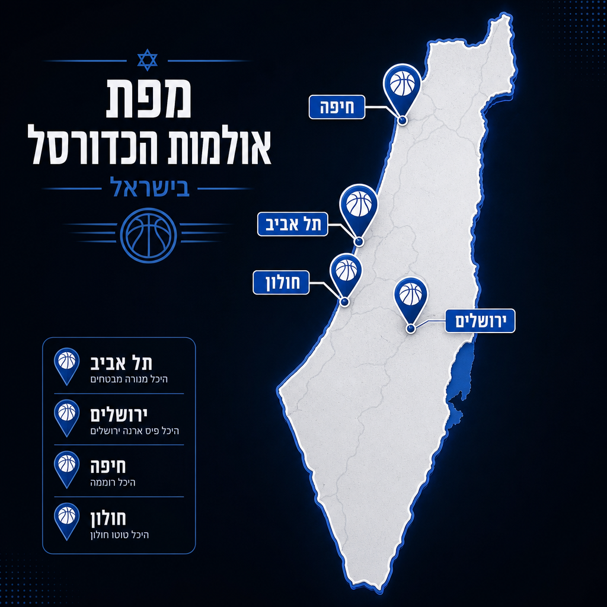
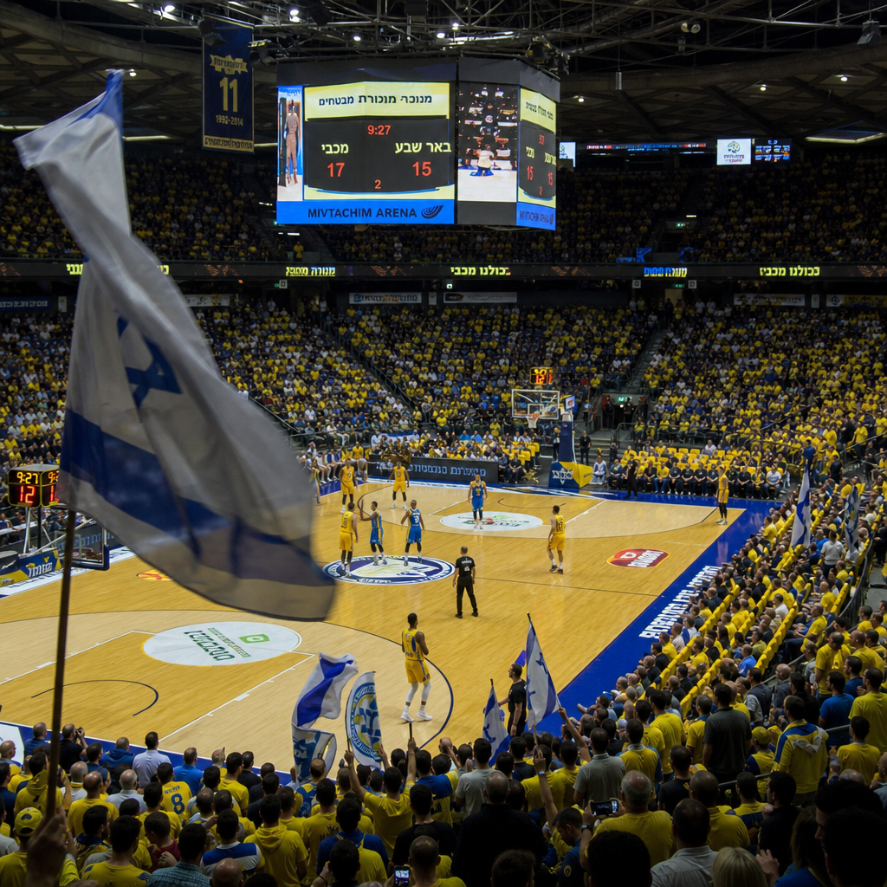
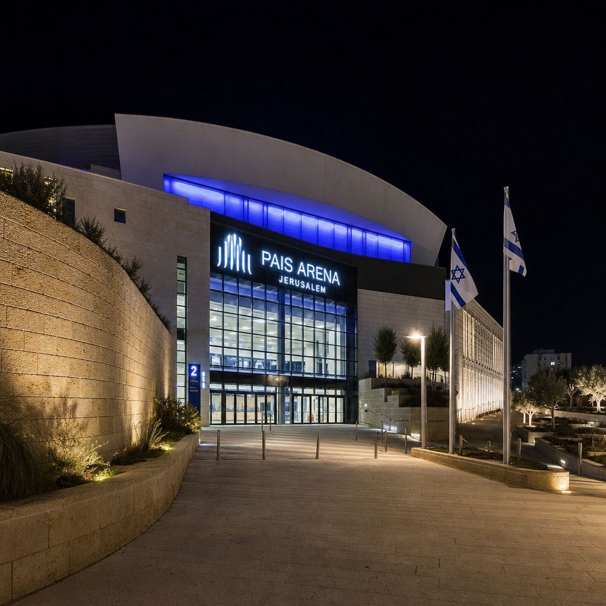

# היכלות הכדורסל של ישראל: הבתים שבנינו למשחק שאהבנו 😉

כדורסל אינו רק ספורט בישראל. הוא שפה. הוא מסורת שמועברת מדור לדור, מאב לבן בטריבונה, מקול הצופר לרעש ההמון. אבל כדי שהמשחק הזה יצלח — צריך בית. צריך היכל. מקום שבו עשרת אלפים אנשים נושמים יחד, צועקים יחד, מפסידים ומנצחים יחד.

ישראל בנתה כמה מהיכלות הכדורסל המרשימים באירופה. חלקם ותיקים ומלאי היסטוריה, חלקם מודרניים ונוצצים. כולם — עדות לכך שהאהבה לכדורסל בארץ הזאת היא לא מקרית, אלא מוּבנית בבטון ובפלדה.

---

## היכל מנורה מבטחים — הבית שלא מזדקן 😉

**תל אביב | 10,383 מושבים | נחנך: 1963**

ביום שישי, ה-17 בספטמבר 1963, נפתח בשכונת יד אליהו בתל אביב מבנה שהיה אז פשוט "היכל הספורט" — אצטדיון פתוח עם ערוגות בטון וכ-5,000 מקומות ישיבה. משחק הבכורה שיחקה נבחרת ישראל נגד יוגוסלביה. לא ידע אז איש שהמקום הזה יהפוך לאחד מהמגרשים הביתיים המאיימים ביותר בכל הכדורסל האירופי.

בין 1968 ל-1971 עבר ההיכל שיפוץ מקיף בתכנונו של האדריכל זאב פורת. הוספה טריבונה עליונה, הותקן גג קבוע, והמתחם קיבל תואר שלא ניתן בקלות: "אחד ממתקני הספורט המתקדמים ביותר באירופה." זה לא היה שיווק — זו הייתה עובדה.

בשנים 2005–2007 הגיע שיפוץ נוסף: אלף מושבים נוספים, 24 בוקסים פרטיים, חנויות ומסעדות. ובשנת 2023, כאילו ההיכל רוצה להוכיח שהוא הולך עם הזמן, הותקנו על גגו פאנלים סולאריים המייצרים עד 252 קילוואט חשמל.

לאורך השנים ענד ההיכל שמות שונים: Nokia Arena בשנות האלפיים המוקדמות, ומ-2015 — היכל מנורה מבטחים, בעסקת שמות בשווי 20 מיליון שקל. אבל לאנשים שגדלו על הטריבונות שלו, הוא תמיד היה פשוט "ההיכל."

מכבי תל אביב שוחקת כאן משנת 1964. הפועל תל אביב חזרה לאחרונה לאולם ב-2025. ביניהן עברו כאן אליפויות אירופה, משחקי גביע דייוויס, והופעות של Julio Iglesias ו-Cyndi Lauper. בהיכל הזה, כדורסל וחיים מתערבבים.

---

## פיס ארנה ירושלים — הגדול מכולם 😉

**ירושלים | 11,000 מושבים | נחנך: 2014**

עיר שלמה חיכתה לה עשרים שנה. הרעיון הראשוני עלה כבר ב-1994: אולם ענק של 15,000 מושבים, ליד הכנסת. אך החשש מאירועים בשבת הקפיא את התוכנית. ב-2004 אישרה עיריית ירושלים בנייה בשכונת מלחה, בניה החלה ב-2009, ובספטמבר 2014 — לאחר מסע של שני עשורים — נפתחה פיס ארנה ירושלים.

עלות הבנייה: 400 מיליון שקל. מתוכם 281 מיליון מימון מפעל הפיס, 33 מיליון מהעירייה, 20 מיליון ממועצת הספורט. ב-11,000 מושבים, זהו האולם הגדול ביותר לכדורסל בישראל.

התכנון שייך לאדריכל ארתור ספקטור, ובמה שנוגע ליכולות: הרצפה נשלפת ומאפשרת הסבה לטניס, הוקי קרח ותערוכות. כ-1,600 מושבים ניתנים להסרה, ומרחיבים את שטח הרצפה ל-2,700 מ"ר. זה לא סתם היכל ספורט — זה מתחם אירועים בעל תפיסת עולם.

הפועל ירושלים, הקבוצה שעלתה מהשוליים להיות אחת הכוחות הגדולים בכדורסל הישראלי, מצאה כאן את ביתה. ב-21 במרץ 2016 נקבע שיא הנוכחות לכדורסל ישראלי: 11,113 צופים בהיכל אחד. מספר שנשמע כמו סטטיסטיקה — אבל בפועל היה רעש.

---

## היכל טוטו חולון — הסגול שמפחיד 😉

**חולון | 5,500 מושבים | נחנך: 2015**

לפני שנת 2015, שיחקה הפועל חולון ב"היכל האחד במאי" — כינויו העממי היה "אולם הפחים." שם לא שיקף זלזול אלא מציאות: מבנה ישן, לא מוחמם, שדרש דמיון מהקהל כדי להתלהב ממנו.

ואז בא ספטמבר 2015, ועמו גביע וינר סל — משחק הבכורה של היכל טוטו החדש. 5,500 מושבים בצבע סגול. שטח של כ-13,000 מ"ר. קבוצה שגדלה לתוך הבניין שנבנה בשבילה.

הפועל חולון, שנוסדה ב-1947 על ידי מיכה שמבן, היא אחת הקבוצות הוותיקות בכדורסל הישראלי. העיר חולון נתנה לה מתנה: היכל שמאפשר לה להתחרות בגדולות, עם קהל שיוצר אווירה בלתי נשכחת. הצבע הסגול אינו מקרי — הוא זהות.

---

## היכל הספורט רוממה — חיפה לא מוותרת 😉

**חיפה | 5,000 מושבים | נחנך: 1976**

בשכונת רוממה שבחיפה עומד היכל שאם תבקר בו היום, לא תאמין שנבנה לפני כמעט חמישים שנה. זה לא בגלל שהוא חדש — אלא בגלל שהוא השתנה.

ב-1976 נפתח ההיכל עם קיבולת של כ-3,000 מושבים. בין 2010 ל-2012 עבר שיפוץ מקיף בעלות 70 מיליון שקל. שטחו כמעט הוכפל: מ-6,000 מ"ר ל-13,000 מ"ר. הקיבולת קפצה ל-5,000 מושבים. זה כמו לבנות היכל חדש בתוך ההיכל הישן.

לאורך השנים נשא ההיכל שמות שונים — ביניהם "היכל רענן כץ" בין 2015 ל-2023, לפני שחזר לשמו המקורי. הוא מארח לא רק כדורסל, אלא גם כדוריד, כדורעף נשים, התעמלות, קטרגל — ומחוץ לספורט: פסטיגל, שבוע הספר, קונצרטים ובלט. חיפה אוהבת להפתיע.

---

## היכל קבוצת שלמה — הבית של הנבחרת 😉

**תל אביב | 3,504 מושבים | נחנך: 2014**

במתחם הדרייב אין של תל אביב, שכבר מזמן חדל להיות קניון סרטים ומחפש זהות חדשה, עלה ב-2014 היכל קבוצת שלמה. הוא הקטן ביותר מבין חמשת ההיכלות הגדולים, אבל מה שחסר לו בקיבולת — הוא מפצה בתפקיד.

ב-4 בינואר 2015 שיחקה כאן לראשונה הפועל תל אביב, נגד הפועל ירושלים — משחק בכורה עם טעם של דרבי. אבל הייעוד האמיתי של ההיכל הזה נמצא מחוץ לליגה המקומית: כאן משחקות נבחרות ישראל. כדורסל גברים, כדורסל נשים, כדוריד, ג'ודו.

ההיכל אירח אליפויות אירופה, גמרי גביע המדינה בכדוריד, וגראנד סלאם בג'ודו. הוא לא שייך לקבוצה אחת — הוא שייך לישראל.

---

## עשרה אלף קולות, מדינה אחת 😉

אפשר למדוד היכלות בקיבולת, בשנות פתיחה, בעלות בנייה. אבל מה שלא ניתן למדידה הוא זה: הרגע שבו עשרת אלפים אנשים קמים על הרגלים, כי הכדור עבר את הקו, כי ניצחנו, כי אנחנו.

כדורסל ישראלי כבש את אירופה בשנות השבעים עם מכבי, ולא הפסיק מאז. ההיכלות האלה — מהישן שביד אליהו ועד החדש בירושלים — הם הראיה שהאהבה הזאת לא פגה. שהיא ממשיכה לקבל כתובת, שטח, ומושבים.

ישראל קטנה. הכדורסל שלה — לא.
